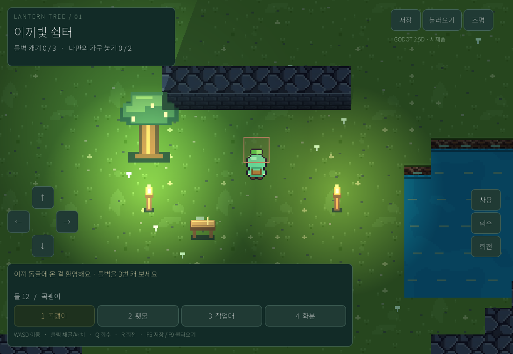
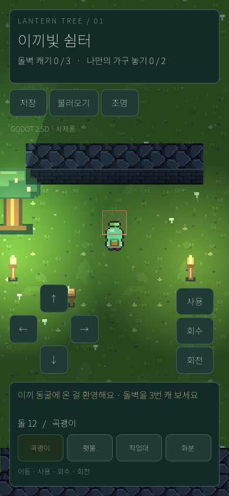

# 시제품 검증 기록

검증일: 2026-10-16. 엔진: Godot 4.4.1 Standard, Compatibility 렌더러.

## 통과

- Godot headless 편집기 가져오기: 스크립트 파싱 및 의존 자산 로드.
- `tests/test_world.gd`: 25개 검사. 생성 위치, 채굴 거리, 3회 채굴과 중복 보상 방지, 배치 비용·물·본인 위치·가구 중복 제한, 충돌, 회수 환급, JSON 왕복, 잘못된 저장 거부 및 현재 상태 보존.
- `--smoke`: 실제 메인 장면 생성, HUD, 횃불 배치와 조명 수, 조명 비교 토글, 임시 저장 파일 생성·불러오기·기존 파일 덮어쓰기 및 재복원. 별도 테스트 저장 경로를 쓰고 삭제함.
- Linux Xvfb + Mesa llvmpipe에서 **실제 Godot OpenGL 화면 렌더링**. 1100×760 가로 및 390×844 세로 화면을 캡처해 확인.
- 시각 확인 중 안내 패널의 과도한 높이와 세로 도구칸 잘림을 수정. 벽 앞면은 아래가 열린 칸에만 표시하며 벽의 밑면을 셀 하단에 정렬.

환경 경고: 소프트웨어 렌더러의 VSync 변경 미지원. 소리는 이번 시제품 범위 밖이며 캡처에서는 Dummy 오디오 드라이버를 사용함.

## 아직 확인하지 않은 것

- 아이폰·안드로이드 실기기, 실제 멀티터치, Safari/WebGL 웹 출력.
- Windows/macOS에서 사용자가 직접 플레이한 결과.
- 저사양 기기 성능, 배터리, 큰 지도, 많은 횃불의 GPU 비용.
- 실제 사용자 플레이에서 채굴·배치의 편의와 미적 완성도.

세로 창 캡처는 아이폰 실기기 검증이 아니며, llvmpipe 결과로 실기기 FPS를 추정하지 않음.

## 캡처

